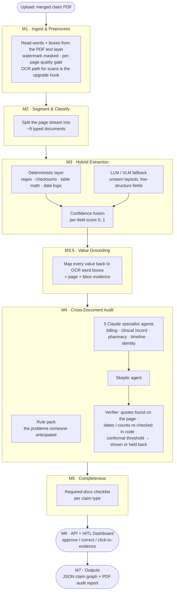
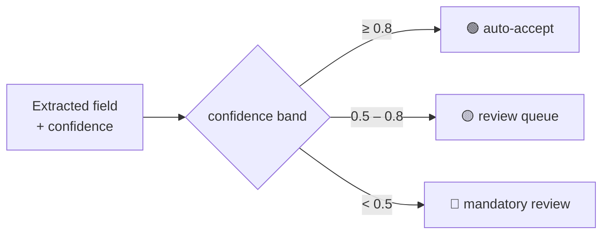

# MediProof

**A claim-readiness audit engine for Indian health-insurance claim files.**


MediProof takes a merged claim file — claim form, discharge summary, hospital bill, pharmacy
bills, lab and radiology reports, prescriptions — and produces:

1. **Structured JSON** of every extracted field, each with a confidence score and evidence.
2. A severity-scored **audit** of documentation problems, from a deterministic rule pack
   **plus a team of Claude agents** that read the whole file — narrative included — and
   must *prove* every item they raise (quotes found on the page, re-checked in code,
   cross-examined by a skeptic agent), with a **certified false-flag rate**.
3. A **patient fix-it checklist** (English / हिन्दी) with the evidence for each item, and a
   claim chat that answers only from the file.
4. A reviewer **dashboard**: click-to-source evidence, the proof and trail behind each agent
   item, confirm / dismiss / promote, a cross-document **timeline** and **evidence map**.

Positioning: a patient/hospital-side **pre-submission audit** — catch the documentation
problems that get claims rejected *before* the file is ever submitted.

> [!IMPORTANT]
> MediProof is **documentation QA**. It does **not** make clinical judgments, adjudicate
> claims, or determine payment. Every output is an input to human review. Findings are
> *review items*, never accusations — the words "fraud" and "reject" appear nowhere in the
> product.

---

## The problem, in one paragraph

A health-insurance claim in India is a stack of 20–40 pages from half a dozen sources: a
hospital bill, a discharge summary, pharmacy receipts, lab reports, a claim form, ID proofs.
Claims get rejected not because the treatment was wrong but because the *paperwork* is
inconsistent — the bill totals don't add up, a medication is billed but never prescribed, a
lab test is charged for but the report is missing, a date is off. MediProof reads the whole
bundle, extracts every field, and cross-checks the documents against each other so a human
reviewer can fix the problems before filing.

## How it works



The core idea is **hybrid extraction**: cheap, deterministic rules do most of the work and
carry the highest confidence; an LLM is only called for the fields rules can't fill. Every
field then gets a confidence score that decides whether a human ever needs to look at it.



This is what makes the headline metric possible: *"review the bottom X% of fields by
confidence to reach Y% accuracy."*

## The agent auditor: open-world, proof-carrying, certified

A rule pack only catches the problems someone thought of in advance. MediProof adds five
specialist Claude agents that read the whole file — including the discharge narrative — and
propose review items. Nothing they say reaches a person unverified:

1. **Proof-carrying.** Every item must quote the documents verbatim; each quote is located on
   its page (that box is what the reviewer and patient click). An unfound quote = held back.
2. **Re-checked in code.** Items about dates, counts or missing reports carry a machine
   check (the two dates must really differ, the date must really fall outside the stay, the
   report's keyword must really be absent from the file).
3. **Cross-examined.** A skeptic agent upholds or rejects each item.
4. **Certified false-flag rate.** The verifier threshold is calibrated by conformal risk
   control on separate clean claims so that P(a clean claim shows ≥ 1 agent item) ≤ α.
   Items below it are *held back*: reviewers see them, patients never do.

The benchmark is built to measure exactly this. Three of the twelve fault families —
**ICU days billed vs. the narrative, a billed imaging study with no report, a one-letter
name variant** — have **no rule on purpose** (`HELD_OUT_FAULTS`). Rules score 0% on them by
construction; the question the eval answers is what the verified agents add without raising
false flags on clean files. Each cross-document check also feeds the claim's shared
**timeline** (every dated event from every document on one calendar) and **evidence map**
(each fact × each document that states it — the within-claim evidence graph).

### Turning the AI on

```bash
cp .env.example .env        # LLM_PROVIDER=gemini + GEMINI_API_KEY (free: aistudio.google.com/apikey)
                            # or LLM_PROVIDER=anthropic + ANTHROPIC_API_KEY (paid API)
make eval-live              # calibrate the threshold on 20 clean claims, then evaluate
```

Everything goes through one client (`pipeline/m3_extract/llm_client.py`) with two providers:
**Gemini** (`gemini-3.5-flash-lite` by default, official `google-genai` SDK; free tier, so calls
are paced and retried on rate limits) or **Claude** (`claude-opus-5-5`, Anthropic SDK, with a
prompt-cached shared dossier, refusal fallback and a hard `LLM_BUDGET_USD` cap). Both use
JSON-schema structured outputs. Live replies are **recorded** to `tests/fixtures/llm/`, so later
runs, tests and CI replay them for free; the README tables name the model that produced them.
Gemini's free tier may use content to improve Google's products — fine for this synthetic
benchmark, not for real patient files. Without a key, the rule pack runs, the agent auditor
is skipped with a note, Hindi details stay in English, and the chat says it's off.

## Benchmarks

Numbers below are produced by `make eval` on **synthetic, digital** claim PDFs (a real
text layer, no OCR noise) — so extraction is near-perfect by construction. The honest
synthetic-to-real gap (scanned/phone-photo documents through the OCR path) is future work
and will be reported openly here rather than hidden.

<!-- BENCHMARK:START -->

_Auto-generated by `make eval` over 28 synthetic claims (16 clean, 12 with a seeded fault). Fully reproducible from seeds._

**Document classification** (P0 keyword baseline)

- accuracy: **100.0%** (226/226 documents)

**Field extraction** (deterministic layer, vs ground truth)

| Document type | Exact match | Normalized match |
|---|---|---|
| claim_form | 100.0% | 100.0% |
| discharge_summary | 100.0% | 100.0% |
| hospital_bill | 100.0% | 100.0% |
| lab_report | 100.0% | 100.0% |
| pharmacy_bill | 100.0% | 100.0% |
| prescription | 100.0% | 100.0% |
| **all** | **100.0%** | **100.0%** |

**Audit engine** (recall per fault family, vs injected ground truth; ★ = held-out family, no rule written for it)

| Fault family | Rules only | Rules + agents |
|---|---|---|
| bill_arithmetic_error | 100.0% (1/1) | 100.0% (1/1) |
| claim_form_date_mismatch | 100.0% (1/1) | 100.0% (1/1) |
| date_mismatch | 100.0% (1/1) | 100.0% (1/1) |
| drug_diagnosis_mismatch | 100.0% (1/1) | 100.0% (1/1) |
| duplicate_billing | 100.0% (1/1) | 100.0% (1/1) |
| inflated_line_item | 100.0% (1/1) | 100.0% (1/1) |
| missing_lab_report | 100.0% (1/1) | 100.0% (1/1) |
| name_mismatch | 100.0% (1/1) | 100.0% (1/1) |
| pharmacy_after_discharge | 100.0% (1/1) | 100.0% (1/1) |
| icu_days_mismatch ★ | 0.0% (0/1) | 100.0% (1/1) |
| missing_imaging_report ★ | 0.0% (0/1) | 0.0% (0/1) |
| name_variant ★ | 0.0% (0/1) | 0.0% (0/1) |
| **all seen** | **100.0%** | **100.0%** |
| **all held-out** | **0.0%** | **33.3%** |

- **Severe review items shown on clean files:** 0.06 per clean claim (0 from rules, 1 from agents, across 16 clean claims).
- **Clean claims showing ≥ 1 agent item:** 1/16; agent items held back by the verifier: 62.
- **Agent auditor model:** `gemini:gemini-3.5-flash-lite` — the agent column measures this model, not any other.
- **Agent auditor cost:** 54 LLM calls, $0.00 live spend this run (replayed and free-tier calls cost $0).

**Coverage–accuracy** (route the lowest-confidence fields to review)

| Sent to review | Auto-accepted | Accuracy of auto-accepted |
|---|---|---|
| 0% | 100% | 100.0% |
| 10% | 90% | 100.0% |
| 20% | 80% | 100.0% |
| 30% | 70% | 100.0% |

**Hybrid unit economics**

- deterministic layer fills **95.9%** of extracted fields; **0 LLM calls** were needed across the whole set (the LLM only touches low-confidence fields).
- median end-to-end latency: **609 ms/claim** (digital path, no OCR).


<!-- BENCHMARK:END -->

## Build status

Built in the open, one module per slice, against [plan.md](plan.md). The end-to-end
pipeline, agent auditor, API, dashboards and eval harness are all in — **167 tests
passing** (pytest + vitest).

| Module | What's in | State |
|--------|-----------|-------|
| `schemas/` | Pydantic v2 contracts; proof-carrying findings; timeline + evidence map | ✅ done |
| `datagen/` | seeded generator, 6 doc templates incl. claim form + radiology, per-claim narratives, **12-family fault injector** (3 held out) | ✅ done |
| `bench/` | **MediClaim-Bench v2**: 240 claims (121 clean, 119 faulty) as ground-truth JSON | ✅ done |
| `m1_ingest` | digital text-layer words+boxes, watermark mask, quality gate | ✅ done |
| `m2_segment` | P0 keyword classifier + boundary detection | ✅ done |
| `m3_extract` | deterministic regex+validators · Claude fallback (record/replay) · confidence fusion | ✅ done |
| `m3.5 ground` | value → bbox evidence (rapidfuzz), incl. DD/MM dates and narratives | ✅ done |
| `m4_audit` | rule pack · **5 Claude agents + skeptic · proof-carrying verifier** · timeline · evidence map | ✅ done |
| `m5_complete` | required-docs checklist | ✅ done |
| `api/` | FastAPI + SQLModel; review · decisions · **patient checklist (en/hi)** · **claim chat** | ✅ done |
| `ui/` | patient site (checklist, chat, Hindi) · reviewer dashboard (proof, trail, decisions, timeline, evidence map) | ✅ done |
| `evals/` | open-world eval (rules vs rules + agents, seen vs held-out) · **conformal calibration** | ✅ done |
| Docker | `docker-compose` (api + dashboard) · `make demo` · Render blueprint | ✅ done |
| Next | first live Claude run + recorded fixtures · OCR / vision path for scans and phone photos · rule distillation from confirmed items · real-sample gap | ⬜ next |

### What works today

The whole thing runs: upload a claim PDF → it's ingested (words + boxes), segmented into typed
documents, extracted field-by-field with per-field confidence, every value grounded to a
bounding box, cross-checked by the audit engine, and served to a dashboard where a reviewer
clicks a finding to see its evidence and corrects fields inline. See the **Benchmarks** above
for the numbers, all produced by `make eval`.

> **Honest scope.** Extraction runs on the **digital text layer** of the synthetic PDFs, so the
> numbers are near-perfect. Real scanned/phone-photo documents need the OCR / vision path —
> the next block of work, and its synthetic-to-real gap will be reported here openly.
>
> **Agent results above are from one free-tier run of `gemini-3.5-flash-lite`** (a small
> model), with **one claim per fault family** — read them as a first signal, not a
> benchmark. The agents caught the held-out ICU-days fault with full proof; they also found
> the one-letter name variant, but it was held back because name items have no code check
> yet and the conformal threshold (0.775, calibrated on 20 separate clean claims) shows only
> items stronger than "skeptic agreed". They missed the absent imaging report. One clean claim
> showed an agent item (1/16, inside the certified ≤ 10%). The agents' first live run also
> found two real flaws in the synthetic data itself (procedure fees billed on medical
> admissions; no break-up of the claimed amount), since fixed. The conformal guarantee holds
> for claims like the synthetic calibration set; on real files it is an estimate.
>
> Replay this run for free (recorded in `tests/fixtures/llm/`):
> `make eval` (no key needed; it defaults to the recording model).

## For reviewers: seeing the AI features without a key

Every AI reply used by the benchmark, the dashboard demo and the **AI test pack**
(`tests/testpack/`: eight synthetic claim PDFs, each built to show one AI feature, with answer
keys and a guide) is recorded in `tests/fixtures/llm/` (model output only, never keys). A
fresh clone replays them by default. No API key, no `.env` and no spend are needed to see:

- **the agent auditor** on all 28 benchmark claims (`make eval`, see the tables above);
- **every test-pack PDF** uploaded in the dashboard: agent findings, held-back items, the
  Hindi checklist, and claim chat for the guide's questions and every "Ask about this" button;
- **the dashboard demo** claim (`make demo`);
- `make testpack-check` verifies all of the above replays, and fails loudly if anything is
  missing.

A claim's id is a fingerprint of its PDF, so uploading a test-pack file replays its recorded
answers. A new file or a new chat question needs a live model: put a free Gemini key in
`.env` (`GEMINI_API_KEY=...`, `LLM_LIVE=1`). The hosted demo (Render, `render.yaml`) keeps
its key in the Render dashboard, never in this repo.

### Gemini model race

Live calls go to several Gemini models at once; the first reply whose every quote is found in
the documents wins (the dashboard shows the winner and its time). Only models that scored
well on the test pack's answer keys race: see [`evals/MODEL_RACE.md`](evals/MODEL_RACE.md),
produced by `make score-models`. The benchmark tables above stay single-model, so their
calibrated false-alarm guarantee is unchanged.

## Quickstart

Requires Python 3.11+ (and Node 20+ / Docker for the dashboard). On Windows, `make` is
optional — use `./run.ps1 <target>` instead.

```bash
# 1. environment + deps (+ headless Chromium for datagen PDF rendering)
python -m venv .venv
make install-dev          # or: ./run.ps1 install-dev

# 2. one synthetic claim (with a seeded inflated line item) → PDFs + ground truth
make datagen-sample       # or: ./run.ps1 datagen-sample

# 3. run the full test suite (golden-file · pipeline · API · eval)
make test                 # or: ./run.ps1 test

# 4. regenerate the benchmark tables above
make eval                 # or: ./run.ps1 eval
```

### See it end-to-end (the dashboard)

```bash
make demo                 # or: ./run.ps1 demo
# builds the compose stack (FastAPI + React), seeds a faulty claim, opens the dashboard:
#   Dashboard  http://localhost:5173     API  http://localhost:8000
```

Or drive the API directly:

```bash
uvicorn api.app:app --reload
curl -F "file=@data/sample/claim.pdf" "http://localhost:8000/claims?claim_id=demo"
curl http://localhost:8000/claims/demo | jq '.findings[] | {type, severity, detail}'
```

A generated ground-truth record looks like this (seed 42, abridged):

```json
{
  "claim_id": "CLAIM-000042",
  "claim_type": "cashless_hospitalization",
  "patient": { "name": "Advik Maharaj", "age": 68, "gender": "M", "patient_id": "UHID207473" },
  "documents": [
    {
      "doc_type": "hospital_bill",
      "hospital": { "name": "Sunrise Multispeciality Hospital", "registration_no": "KA/HOSP/2011/4471" },
      "admission_date": "2024-09-09",
      "discharge_date": "2024-09-12",
      "line_items": [
        { "description": "Room Rent (Semi-Private)", "quantity": 3.0, "unit_price": 3719.62, "amount": 11158.86 }
      ]
    }
  ]
}
```

## Repo layout

```
schemas/     Pydantic v2 contracts — the single source of truth (see CLAUDE.md)
datagen/     synthetic generator (MediClaim-Bench) + fault injector
bench/       MediClaim-Bench v2 ground truth (240 claims; PDFs regenerate from seeds)
pipeline/    m1_ingest · m2_segment · m3_extract · m4_audit (rules + agents) · m5_complete
api/         FastAPI app (+ patient checklist and claim chat)
ui/          React: patient site + reviewer dashboard
evals/       eval harness (CLI), conformal calibration
tests/       pytest; golden-file tests per module
```

## Design principles

These are enforced conventions, not aspirations (full text in [CLAUDE.md](CLAUDE.md)):

- **Contracts-first.** `schemas/` is the single source of truth. Every module imports its
  types from there; a schema change is a breaking change to everything downstream.
- **Deterministic seeds everywhere.** A fixed seed reproduces byte-identical ground truth —
  reproducibility is non-negotiable and CI checks it.
- **LLM record/replay.** Every LLM call goes through one thin client that records responses
  to fixtures. Tests and CI replay from fixtures — deterministic, free, fast. Live calls
  only behind `LLM_LIVE=1`, under a hard `LLM_BUDGET_USD` cap.
- **The pipeline never crashes on a bad LLM reply.** A reply must parse into the target
  field's schema; on failure it retries with error feedback (max 2), then emits
  `value=null, confidence=0`.
- **Golden-file tests per module.** Input fixtures → expected JSON outputs, checked in.
  Regressions fail CI.

## Data, safety & ethics

- **Synthetic only.** The public repo and the MediClaim-Bench dataset contain synthetic data
  only. All hospitals, labs, and insurers are fictional; every page carries a
  `SPECIMEN — SYNTHETIC DATA` watermark.
- **Privacy (DPDP posture).** Health data is sensitive personal data. Any real sample used
  for the synthetic-to-real honesty check stays local, is de-identified first, and is
  **never** committed. A CI PII scan (Aadhaar / PAN / phone patterns) guards every push.
- **Reproducible & auditable.** Because datagen is fully seeded, every reported number can be
  regenerated from a seed.
- **Sources.** ICD-10 (WHO), drug names from open government lists (Jan Aushadhi / NLEM),
  non-payable consumables from the IRDAI-aligned standard list — cited as the datasets land.

## License

[Apache-2.0](LICENSE). Contracts in `schemas/` are human-owned; see [CLAUDE.md](CLAUDE.md)
for the agent conventions that keep this AI-assisted codebase coherent.
